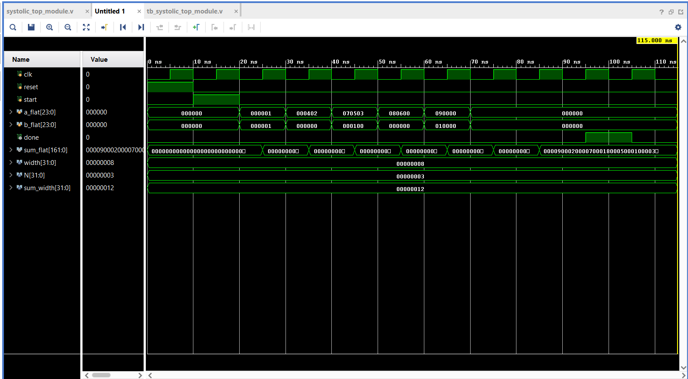
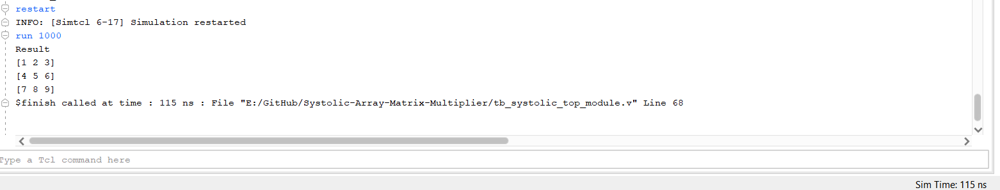

# Parameterized $N \times N$ Systolic Array Matrix Multiplier (AI Hardware Accelerator Core)

A synthesizable, parameterized **$N \times N$ Systolic Array** designed in standard Verilog-2001 and verified in Xilinx Vivado. Built to accelerate matrix multiplication ($C = A \times B$) for neural network inference using rhythmic wavefront data propagation and a 4-state Finite State Machine (FSM) controller.

---

## Architecture Overview

```text
                 +-------------------------------------------------------+
                 |                  systolic_top_module                  |
                 |                                                       |
                 |   +--------------------+       +------------------+   |
 start --------->|-->|  systolic_nxn_fsm  |--pe_en|  systolic_nxm    |   |
                 |   |    (Controller)    |--row_e|    (Datapath)    |   |
                 |   +--------------------+  col_e+------------------+   |
                 |                             |            ^            |
 a_flat ---------|------->[ Data Gating ]------+            |            |
                 |        (Muxing Logic)       ------------/             |
 b_flat ---------|------->[ Data Gating ]------------------/             |
                 |                                                       |
 sum_flat <------|-------------------------------------------------------|
 done <----------|-------------------------------------------------------|
                 +-------------------------------------------------------+
```

### Module Hierarchy
* **`PE.v` (Processing Element):** Single Multiply-Accumulate (MAC) unit computing $\text{sum} \Leftarrow \text{sum} + (A_{\text{in}} \times B_{\text{in}})$ while forwarding inputs right and down on every enabled clock edge (`pe_en`).
* **`systolic_nxm.v` (Parameterized Datapath):** Uses nested `generate` loops to instantiate an $N \times M$ PE grid with flattened 1D ports (`+:`) and overflow-safe accumulator sizing (`2*width + $clog2(cols)`).
* **`systolic_nxn_fsm.v` (Control Unit):** Latch-free 4-state FSM (`IDLE` $\to$ `STREAM` $\to$ `DRAIN` $\to$ `DONE`) that manages diagonal input skewing over $2N - 1$ cycles and pipeline draining in $3N - 2$ cycles.
* **`systolic_top_module.v` (Top-Level Wrapper):** Integrates the datapath and FSM, gating inactive rows/columns to `0` via `row_en` and `col_en`.
* **`tb_systolic_top_module.v` (Testbench):** Verifies cycle-accurate $3 \times 3$ matrix multiplication ($A \times I_3 = A$) in Vivado Behavioral Simulation.

---

## Repository Structure

```text
├── PE.v                      # Base Multiply-Accumulate (MAC) Processing Element
├── systolic_nxm.v            # Parameterized NxM Systolic Array Datapath
├── systolic_nxn_fsm.v        # 4-State FSM Control & Skewing Unit
├── systolic_top_module.v     # Top-Level Integrated Wrapper with Data Gating
├── tb_systolic_top_module.v  # Self-Checking Behavioral Testbench (N=3)
├── results/
│   ├── waveform.png          # Vivado Behavioral Simulation Waveform
│   └── tcl_output.png        # Vivado Tcl Console Matrix Output
└── README.md
```

---

## Simulation & Verification Results

Simulated in **Xilinx Vivado** ($N = 3$, $\text{width} = 8$, $10\text{ ns}$ clock period) multiplying:

$$A = \begin{bmatrix} 1 & 2 & 3 \\ 4 & 5 & 6 \\ 7 & 8 & 9 \end{bmatrix}, \quad B = \begin{bmatrix} 1 & 0 & 0 \\ 0 & 1 & 0 \\ 0 & 0 & 1 \end{bmatrix}$$

### 1. FSM State & Datapath Waveform
Shows state transitions (`IDLE` $\to$ `STREAM` $\to$ `DRAIN` $\to$ `DONE`), diagonal `row_en`/`col_en` gating, and the final `done` assertion.



### 2. Vivado Tcl Console Output
Prints the unpacked $3 \times 3$ result matrix (`[1 2 3] [4 5 6] [7 8 9]`) at $115\text{ ns}$.



---

## How to Run (Vivado Tcl Flow)

1. Open **Xilinx Vivado** and navigate to the repository directory in the Tcl Console:
   ```tcl
   cd E:/GitHub/Systolic-Array-Matrix-Multiplier
   ```
2. Compile, elaborate, and launch the simulation GUI:
   ```tcl
   xvlog PE.v systolic_nxm.v systolic_nxn_fsm.v systolic_top_module.v tb_systolic_top_module.v
   xelab -debug typical -top tb_systolic_top_module -snapshot systolic_snap
   xsim systolic_snap -gui
   ```